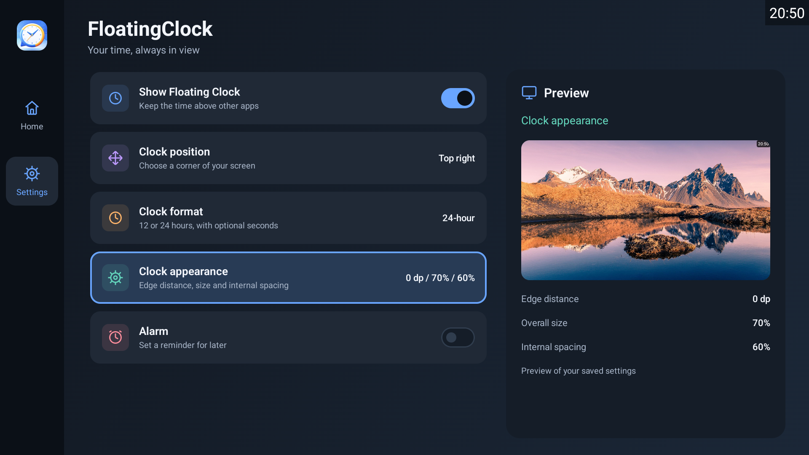
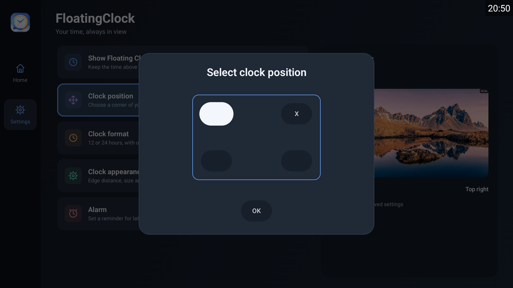
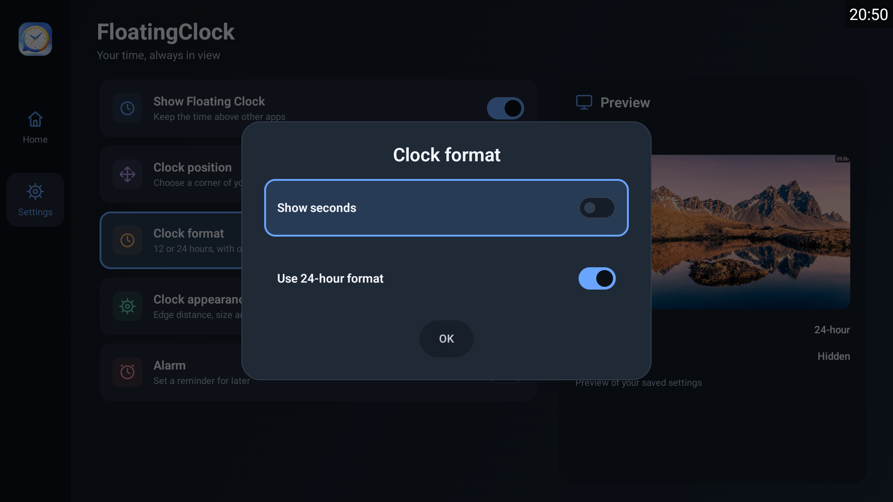
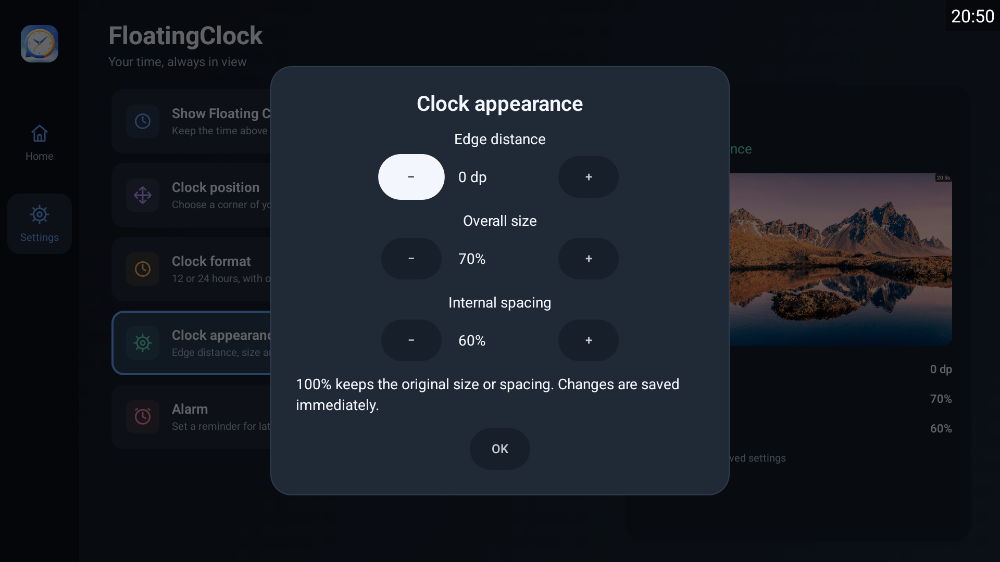
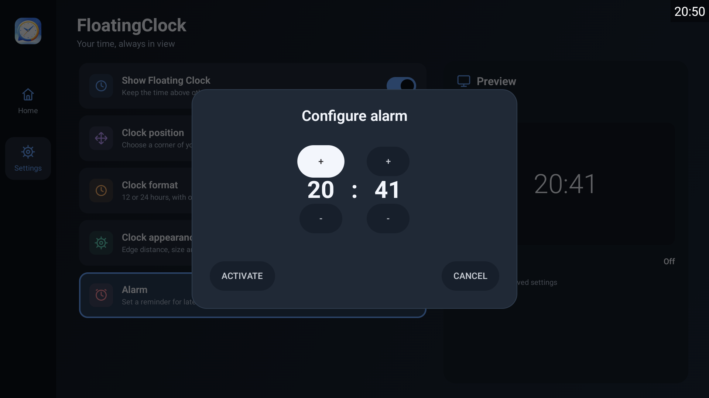

# FloatingClock (Android TV)

FloatingClock is a lightweight Android TV app that shows the current time and can display a floating clock overlay on top of other apps. It also includes an alarm that can ring while you are watching videos or using other apps.

## Screenshots and Media

- Dashboard with the existing settings and a supplementary appearance preview


- Clock position dialog (same four-corner controls)


- Clock format dialog (same format and seconds switches)


- Clock appearance dialog (same three stepper controls)


- Alarm dialog (same time, ACTIVATE, and CANCEL controls)


- Floating Clock Overlay


- Floating Clock Overlay (Ringing)


## Demo

https://github.com/user-attachments/assets/8370ff31-11fa-409f-b0de-d630d15c747f

## Features

- Live clock on the main screen.
- Floating overlay clock that stays visible on top of other apps.
- Selectable overlay position (four screen corners).
- Clock format settings (12/24-hour and optional seconds).
- Adjustable floating clock edge distance, overall size, and internal spacing, saved between sessions.
- Alarm with HH:MM configuration in 24-hour format.
- Alarm sound plays in the background and the overlay clock blinks red while it is active.
- Alarm can be dismissed by entering the app and selecting the Alarm row.

## Languages

The app follows the Android system language automatically and works offline in
English, Spanish, Portuguese, and French. Regional settings such as Spanish
(Argentina), Portuguese (Brazil or Portugal), and French (Canada) use the shared
language translation. On Android 7+ the system's ordered language preferences are
used; if none match, app text falls back to English. There is no language selector
inside the app and no stored language override. Change the language in Android's
system settings. Existing 12/24-hour and seconds choices remain unchanged.

All app-owned text includes dialogs, previews, accessibility descriptions, permission
feedback, notifications, and notification channel names. Android controls its own
permission and Settings screen text. The FloatingClock brand and universal symbols
(+/−, selection markers, time separators) are intentionally shared.

### Contributing translations

- Canonical English messages: `app/src/main/res/values/strings.xml`.
- Complete translated catalogs: `values-es`, `values-pt`, and `values-fr` under the
  same resource directory. Generic language folders cover regional variants.
- Use semantic `snake_case` resource names and translator comments. Translate whole
  messages and preserve numbered arguments (`%1$d`, `%2$s`) and literal percent
  escapes (`%%` in formatted values). Use `formatted="false"` for prose with a
  literal percent sign that does not accept substitutions. Do not concatenate
  English word fragments or use displayed text as a navigation identifier.
- Only documented brand/control-symbol resources can be `translatable="false"`.
  An English fallback is a runtime safeguard, not a completed translation.
- To add a language, add a complete `values-<language>/strings.xml`, extend
  `androidResources.localeFilters` in `app/build.gradle.kts`, update this coverage
  list and the resource-resolution tests, and verify text/focus on Android TV.
  Existing clock and alarm logic does not need a language branch.

Run `bash ./gradlew :app:verifyTranslations :app:testTranslationVerifier` to check
catalog completeness and placeholder compatibility and exercise malformed fixtures.
These checks also run with `:app:check`. New plurals must provide all applicable
quantities (including `other`); the current four languages' requirements are
encoded in `tools/TranslationVerifier.java`. Review those rules when adding a
language with different plural categories. Android compilation/lint validates
resource syntax and formatting; inspect Kotlin text consumers too, because equal
catalog keys cannot detect every hardcoded UI string.

## How It Works

1) The overlay switch starts a foreground service that draws a small clock window using `SYSTEM_ALERT_WINDOW`.
2) The alarm schedule uses `AlarmManager` to trigger at the selected time.
3) When the alarm fires, a foreground service plays an alarm sound and broadcasts alarm state updates.
4) The floating clock listens for those updates and blinks red while the alarm is active.

## Permissions Used

- `SYSTEM_ALERT_WINDOW`: Required to draw the floating overlay clock.
- `FOREGROUND_SERVICE` and `FOREGROUND_SERVICE_SPECIAL_USE`: Required for the overlay service.
- `FOREGROUND_SERVICE_MEDIA_PLAYBACK`: Required for the alarm sound service.
- `POST_NOTIFICATIONS`: Required on Android 13+ for foreground service notifications.
- `SCHEDULE_EXACT_ALARM`: Used when available to schedule exact alarms.

## Usage

1) Open the app and toggle **Show Floating Clock** to enable the overlay.
2) Use **Clock position** to choose a corner for the overlay.
3) Use **Clock format** to toggle 12/24-hour format and show/hide seconds.
4) Use **Clock appearance** to change **Edge distance** (0–128 dp, steps of 4 dp, default 16 dp), **Overall size** (50–200%, steps of 10%, default 100%), and **Internal spacing** (0–300%, steps of 10%, default 100%) with the remote’s **−** and **+** buttons.
5) Go to **Alarm** row to set the alarm time.
6) Press **ACTIVATE** to schedule the alarm or **CANCEL** to disable it.
7) When the alarm rings, the overlay clock blinks red and an alarm sound plays.
8) Open the app and select the **Alarm** row to stop the alarm immediately.

Appearance changes apply and save immediately. **OK** or Back closes the modal and keeps your adjustments. At 100%, size and spacing match the original overlay; overall size scales both text and padding, while internal spacing changes only padding when space permits. The same edge distance applies to both edges of the selected corner. If the requested clock cannot fit, it is scaled down and its edge distance limited to keep the complete time visible, without changing your saved choices. These controls do not resize the main screen clock.

## Notes

See [AGENTS.md](AGENTS.md) for Codex guidance and development checks.

- On some Android TV devices or emulators, exact alarms may not be allowed. In that case, the app falls back to a best-effort schedule.
- If the emulator has no default alarm sound, the app falls back to a simple beep tone.

## Dashboard layout

The dashboard places the app logo and **Home** / **Settings** shortcuts in a left rail, the app name and live clock in the header, the existing settings rows on the left, and a supplementary preview on the right. Both shortcuts stay within the same screen: Home returns the settings list to its start with the header visible; Settings also focuses the first setting. D-pad and Select operate the existing controls, and Back retains its current dialog/exit behavior.

The large header clock is shown only while the floating clock is disabled. The miniature floating clock is drawn over the preview landscape only while the floating clock is enabled; the landscape remains visible when it is off.

The TV preview uses a bundled landscape photograph, with the configured clock drawn live on top. It works offline and uses a centered crop to fill the existing frame without stretching the photograph.

Moving focus between rows with the remote updates the read-only preview immediately, without opening a dialog or changing settings. **OK/Select** or tap performs the same action as before: the floating-clock row toggles the overlay, configuration rows open their dialogs directly, and a ringing alarm can be dismissed from its row. A modal may temporarily cover the preview; closing it reveals the accepted values. There is no additional editing step, and all existing controls, ranges, and save behavior are retained.

The advertising banner and its placeholder are hidden. No bottom space is occupied by advertising; integration remains future work.

## Development with Codex

OpenSpec workflows are installed in `.agents/skills/`, with project context in
`openspec/config.yaml`. Use `$openspec-explore` to investigate an idea,
`$openspec-propose "your idea"` to prepare a change, `$openspec-apply-change` to
implement it, and `$openspec-archive-change` after implementation and verification.
Small fixes can be requested directly.

Install Android SDK Platform 36 and use a JDK compatible with AGP 8.13.2
(17 or newer). Keep the SDK path in the ignored `local.properties` file.
From the repository root on macOS/Linux:

```sh
bash ./gradlew --version
bash ./gradlew :app:assembleDebug
bash ./gradlew :app:lintDebug
bash ./gradlew :app:testDebugUnitTest
bash ./gradlew :app:verifyTranslations :app:testTranslationVerifier
# With an explicitly selected test device:
ANDROID_SERIAL=emulator-5554 bash ./gradlew :app:connectedDebugAndroidTest
```

The debug APK is generated at `app/build/outputs/apk/debug/app-debug.apk`.
Local regression tests cover appearance preferences, geometry, and locale-sensitive clock formatting.
Instrumented tests cover regional/fallback resource resolution, translated dashboard actions,
remote Select/Back, and notification channel label updates. Run them with each system
language on an explicitly selected Android TV test device. Validate affected remote navigation,
overlay and alarm behavior on an Android TV emulator or device as well.
